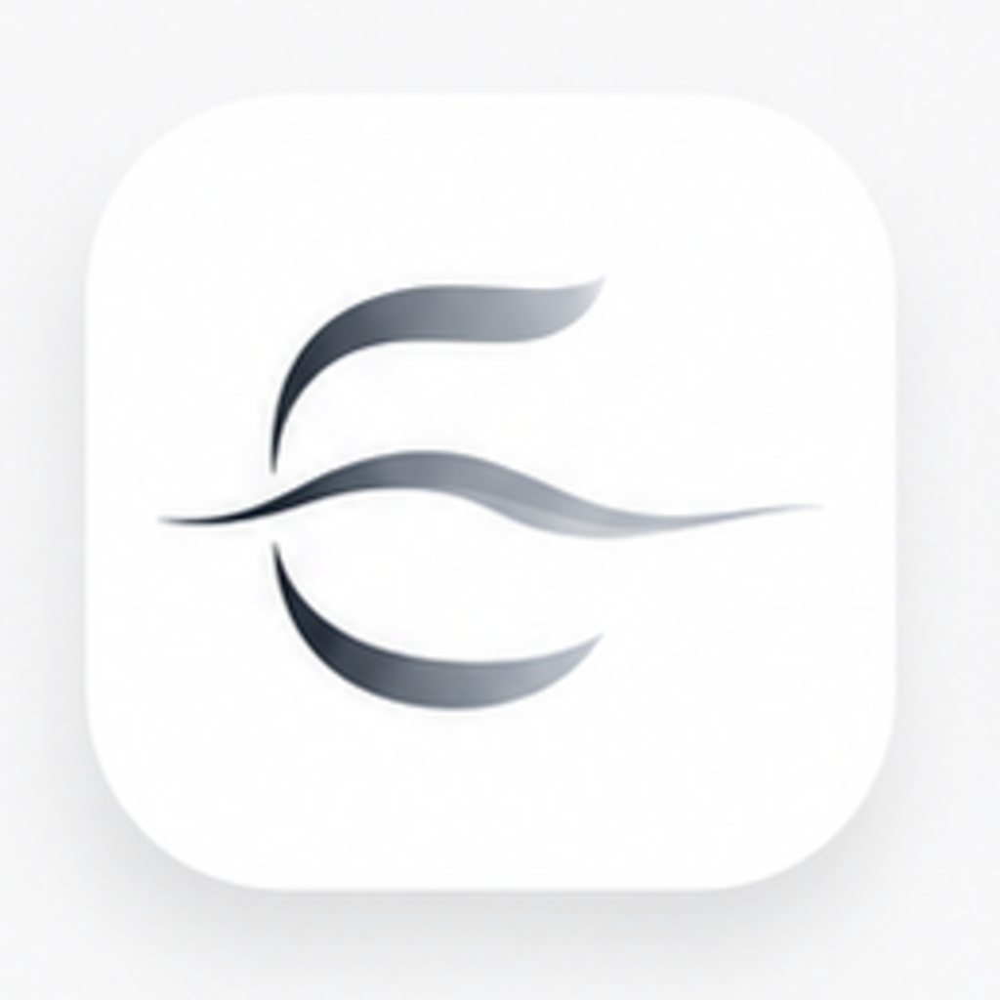

<p align="center">
  
</p>

<h1 align="center">ElegantWhisper</h1>

<p align="center">
  Native voice input for macOS.<br>
  Tap Right Option, speak naturally, and insert polished text anywhere.
</p>

<p align="center">
  <a href="https://github.com/AetherAllan/ElegantWhisper/actions/workflows/ci.yml"></a>
  
  
</p>

<p align="center">
  
</p>

ElegantWhisper is a macOS 26+ Dock and menu-bar voice input app built with AppKit. It records with a single Right Option tap, transcribes with Apple's Speech framework, optionally applies OpenAI-compatible Style Pack polishing, then inserts the final text into the focused editable field when it is safe to do so.

## Why ElegantWhisper

- **Native macOS experience** - AppKit window, menu-bar controls, global hotkey, and compact floating bar.
- **One-key dictation** - Tap Right Option to start, tap Right Option again to stop and transcribe.
- **Automatic insertion** - Inserts into the focused editor when possible; otherwise keeps the result on the clipboard.
- **Personal dictionary** - Correct project names, technical terms, people, and recurring recognition mistakes.
- **Optional polishing** - Use OpenAI-compatible providers and Style Packs for conservative recognition cleanup.
- **Local history** - Completed dictations are saved locally and canceled recordings are ignored.

## How It Works

1. Focus a text field in another app.
2. Tap Right Option to start recording.
3. Speak naturally while the floating bar shows audio level and partial text.
4. Tap Right Option again to stop.
5. ElegantWhisper finalizes the transcript, applies local corrections, optionally runs polishing, and inserts or copies the result.

Command shortcuts such as Cmd+V/C/A/Z and Option combined with other keys keep normal macOS behavior and do not start or stop recording.

## Privacy

- History, dictionary entries, Style Packs, and settings are stored locally.
- API credentials are stored in the macOS Keychain.
- LLM polishing is disabled by default.
- When polishing is enabled, only the recognized text is sent to the configured API provider.
- Audio is processed through Apple's Speech framework.

## Requirements

- macOS 26 or newer
- Xcode 26.6 and Swift 6.3 to build
- Microphone permission
- Speech Recognition permission
- Accessibility permission
- Input Monitoring permission

## Installation For Local Development

Create a local signing config once:

```sh
cp Signing.xcconfig.example Signing.xcconfig
```

Then edit `Signing.xcconfig` and replace `YOUR_TEAM_ID_HERE` with your Team ID from **Xcode -> Settings -> Accounts**. This file is gitignored; certificates and private keys stay in your macOS Keychain.

Build and run from Xcode:

```sh
open ElegantWhisper.xcodeproj
```

Or use SwiftPM:

```sh
make build
make run
```

Create a signed SwiftPM app bundle:

```sh
make install
```

The app bundle is created at:

```text
build/ElegantWhisper.app
```

The Makefile signs with the first available Apple Development identity when possible, and falls back to ad-hoc signing if none is available:

```sh
make sign-info
```

For distribution outside your own machine, use a Developer ID certificate and Apple notarization. See [docs/RELEASE.md](docs/RELEASE.md).

## Permissions

On first launch, ElegantWhisper shows a permissions window. Grant each required permission from that window. Global hotkeys do not start until Accessibility and Input Monitoring are granted.

### Microphone

System Settings -> Privacy & Security -> Microphone -> enable ElegantWhisper.

`make install` signs the app with `Resources/ElegantWhisper.entitlements`, including `com.apple.security.device.audio-input`. If you manually re-sign the app, include that entitlements file; otherwise hardened runtime can block microphone access.

### Speech Recognition

System Settings -> Privacy & Security -> Speech Recognition -> enable ElegantWhisper.

ElegantWhisper uses Apple's Speech framework for transcription, and this permission makes that privacy boundary explicit.

### Accessibility

System Settings -> Privacy & Security -> Accessibility -> enable ElegantWhisper.

Accessibility is required to find the focused editable field and perform simulated Cmd+V insertion.

### Input Monitoring

System Settings -> Privacy & Security -> Input Monitoring -> enable ElegantWhisper.

Input Monitoring is required for Right Option detection while ElegantWhisper is in the background or while another app is focused. ElegantWhisper checks Apple's ListenEvent permission with `CGPreflightListenEventAccess()` and `IOHIDCheckAccess(kIOHIDRequestTypeListenEvent)`, then starts a listen-only `CGEventTap`. If that tap cannot be created on a developer build, it falls back to an `IOHIDManager` keyboard listener that uses the same Input Monitoring permission.

After enabling Input Monitoring, quit and reopen ElegantWhisper. macOS often requires a relaunch before a newly granted ListenEvent permission is visible to the running process.

The menu bar includes `Permissions Status` with shortcuts to the relevant System Settings panes.

## Settings

Open `Open ElegantWhisper` from the menu bar to configure:

- API Base URL, API Key, Model, and request timeout
- Whether to keep text on the clipboard when no editable field is available
- Whether to save local transcription history
- Personal dictionary terms and common wrong recognition forms
- Style Pack prompt templates for LLM polishing

History is stored at:

```text
~/Library/Application Support/ElegantWhisper/history.json
```

Dictionary entries are stored at:

```text
~/Library/Application Support/ElegantWhisper/dictionary.json
```

Style Packs are stored at:

```text
~/Library/Application Support/ElegantWhisper/style-packs.json
```

`LLM Refinement` is disabled by default. When enabled, it sends only the final recognized text to an OpenAI-compatible `/chat/completions` endpoint and uses the active Style Pack prompt. Use `{{HOTWORDS}}` where dictionary terms should be injected.

## Languages

The `Language` menu supports:

- English
- 简体中文
- 繁體中文
- 日本語
- 한국어

The selected language is saved in the `com.aetherallan.ElegantWhisper` UserDefaults suite. The API key is stored in the macOS Keychain under the same stable service name.

## CI/CD

CI runs on GitHub Actions for every push to `main` and every pull request. It verifies:

- `swift test`
- `swift build -c release --product ElegantWhisper`
- unsigned Xcode Release build

Release CD is intentionally not enabled yet. Public distribution requires Developer ID signing, Apple notarization, and GitHub Secrets. See [docs/RELEASE.md](docs/RELEASE.md) for the release checklist.

## Stable Identifiers

- Product name: `ElegantWhisper`
- Executable name: `ElegantWhisper`
- App bundle: `ElegantWhisper.app`
- Bundle identifier: `com.aetherallan.ElegantWhisper`
- Application Support: `~/Library/Application Support/ElegantWhisper/`
- Transcription: Apple Speech framework
- UserDefaults suite: `com.aetherallan.ElegantWhisper`
- Keychain service: `com.aetherallan.ElegantWhisper`

## Manual Verification

After building, manually verify:

- Right Option alone starts and stops recording.
- Cmd+V/C/A/Z and Option with other keys still work normally.
- The floating recording panel does not steal focus from the original app.
- Text inserts into TextEdit, browser address fields, web inputs, and chat inputs.
- Switching to another editable field during transcription inserts into the current field.
- With no editable field, the result stays on the clipboard.
- Completed dictations appear in History; canceled dictations do not.
- Dictionary entries replace configured wrong forms after the final transcript.
- LLM failures fall back to the raw Apple Speech result.
- Style Pack prompt edits persist after relaunch, and Reset restores built-in prompts.
